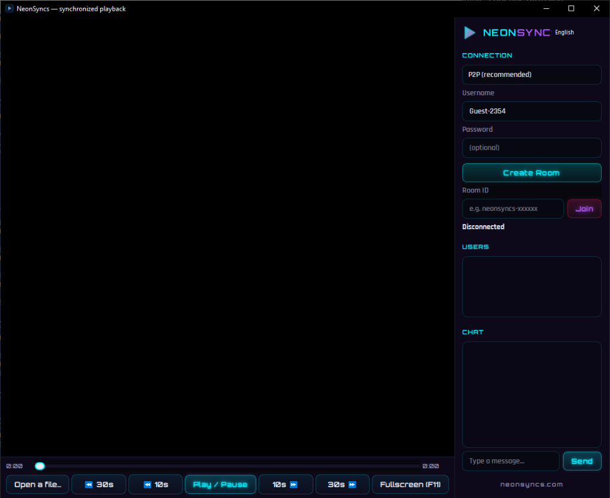

# NeonSyncs

NeonSyncs is a Windows desktop application for watching local video files in sync with other people. It embeds mpv, connects participants peer-to-peer and keeps playback aligned across clients.



## Overview

NeonSyncs allows two or more people to watch the same local video file together over the Internet. It synchronizes playback state, pause, and seek actions so that all participants stay aligned.

The application includes an embedded video player powered by libmpv, a peer-to-peer networking layer using WebRTC and PeerJS, an integrated chat panel, and a legacy client-server mode.

Official website: https://neonsyncs.com

## Features

- Peer-to-peer rooms with generated short IDs (for example `neonsyncs-xxxxxx`).
- Optional room password protection for private watch sessions.
- Host-relayed star topology supporting watchparties with more than two participants.
- Clock synchronization using ping latency estimation and scheduled playback actions.
- Playback drift correction with jump thresholds and cooldown intervals.
- Embedded mpv video player without external playback windows.
- Seekable progress bar reflecting current playback position and total duration.
- Local volume control slider with mute button and persistent volume settings.
- Local subtitles: external SRT, ASS and VTT files and embedded tracks, with delay adjustment.
- Jump controls with dedicated 10 s jump buttons plus the Left and Right arrow keys (10 s).
- Fullscreen mode (F, F11, Escape, or double-click on the video; Space toggles play and pause in fullscreen) that hides all side panels and controls.
- Integrated text chat and participant user list.
- Warning banner when participants load video files with differing names or durations.
- Four interface languages: English, French, Russian, and Arabic with Right-To-Left layout and live in-app switching via header language button.
- Windows installer available in all four languages with clean desktop shortcuts.
- Legacy client-server mode (`server.py`) over TCP sockets with password support.
- Custom STUN and TURN server configuration via `p2p/ice_servers.json`.

## Installation

Pre-built Windows installers are published on the [Releases page](https://github.com/Th3Gold3nRainbow/NeonSyncs/releases).

1. Download `NeonSyncs-Setup.exe` from the latest release.
2. Run the installer and choose your language: English, Français, Русский, or العربية.
3. Follow the setup wizard to complete installation.
4. Launch NeonSyncs from your Start Menu or Desktop shortcut.

To uninstall NeonSyncs, use Windows Settings > Apps > Installed apps, or Control Panel > Programs and Features. The uninstaller offers an option to remove user settings stored in `%APPDATA%\NeonSyncs`.

## Usage

### Peer-to-Peer Mode (Default)

1. Open a local video file by clicking Open a file. Both you and your participants must have the identical video file saved locally.
2. Select P2P (recommended) from the Mode dropdown.
3. Set your username and an optional room password.
4. If hosting: click Create Room. Copy the generated Room ID and send it to your participants.
5. If joining: paste the Room ID into the Room ID field and click Join.
6. Play, pause, and seek actions are automatically shared across all connected clients.

### Legacy Server Mode

For environments where peer-to-peer connections cannot be established, you can run the standalone Python server:

```cmd
python server.py --port 8999 --password secret
```

In the NeonSyncs application:
1. Select Server in the Mode dropdown.
2. Enter the server Host IP, Port, Room name, and Password.
3. Click Connect.

## Configuration

### STUN and TURN Relays

WebRTC peer-to-peer connections require signaling and network traversal. By default, NeonSyncs uses public Google STUN servers. If your network is behind a symmetric NAT or restrictive firewall, configure a TURN relay server in `p2p/ice_servers.json`:

```json
{
  "iceServers": [
    {
      "urls": "stun:stun.l.google.com:19302"
    },
    {
      "urls": "turn:turn.example.com:3478",
      "username": "user",
      "credential": "password"
    }
  ]
}
```

### Application Settings

User preferences, including the active language selection and installer state, are saved in `%APPDATA%\NeonSyncs\settings.json`.

## Building from Source

For detailed Windows build and packaging instructions, see [docs/building-windows.md](docs/building-windows.md).
For internationalization and language priority architecture, see [docs/localization.md](docs/localization.md).

### Prerequisites

- Windows 10 or Windows 11 (64-bit)
- Python 3.10 or later
- Git for Windows
- Inno Setup 6 (optional, required only for building the installer)

### Setup Steps

1. Clone the repository:

```cmd
git clone https://github.com/Th3Gold3nRainbow/NeonSyncs.git
cd NeonSyncs
```

2. Download `libmpv-2.dll` (64-bit Windows build) from [mpv-winbuild-cmake releases](https://github.com/shinchiro/mpv-winbuild-cmake/releases). Extract `libmpv-2.dll` into the repository root directory as `mpv-2.dll`.

3. Create and activate a Python virtual environment:

```cmd
python -m venv venv
call venv\Scripts\activate.bat
pip install -r requirements.txt
pip install pyinstaller
```

4. Build the standalone executable:

```cmd
build_exe.bat
```

The compiled binary is generated at `dist\NeonSyncs.exe`.

5. Build the Windows installer:

```cmd
build_installer.bat
```

The resulting setup executable is generated at `Output\NeonSyncs-Setup.exe`.

## Architecture

- **User interface**: Built with PyQt5, styled with a custom Cyber Cyan dark stylesheet and bundled typography (Orbitron and Rajdhani).
- **Video engine**: Embedded libmpv window rendered inside a Qt QFrame using the native window identifier (`wid`).
- **P2P signaling and data channels**: Powered by PeerJS running inside a hidden QWebEngineView instance, communicating with Python through a QWebChannel bridge.
- **Synchronization protocol**: Host-relayed state broadcasting. When an action occurs (play, pause, or seek), the host schedules an execution timestamp (`executeAt`) adjusted for peer network latency.
- **Internationalization**: Custom JSON catalog engine (`i18n.py`) supporting dynamic in-app switching, format interpolation, and bidirectional layout adjustments.

## Known Limitations

- All participants must have the identical video file locally. NeonSyncs synchronizes playback position and state; it does not stream video data over the network.
- Peer discovery relies on the shared PeerJS Cloud signaling network.
- Without a configured TURN server, direct peer connections may fail across certain strict NAT routers or corporate firewalls.
- If the host leaves or closes the application, the peer-to-peer room closes.
- The installer executable is not signed with a commercial Authenticode certificate. Windows SmartScreen may show an unknown publisher warning upon initial download.

## Contributing

Bug reports and contributions are welcome. Please open an issue on the GitHub repository using the bug report template, or submit a pull request with clear commit messages.

## License

The source code of NeonSyncs is licensed under the MIT License. See [LICENSE](LICENSE) for details.

Pre-compiled binary distributions bundle PyQt5, PyQtWebEngine, and libmpv, which are subject to the GNU General Public License version 3. See [THIRD_PARTY_NOTICES.md](THIRD_PARTY_NOTICES.md) for full licensing information.
